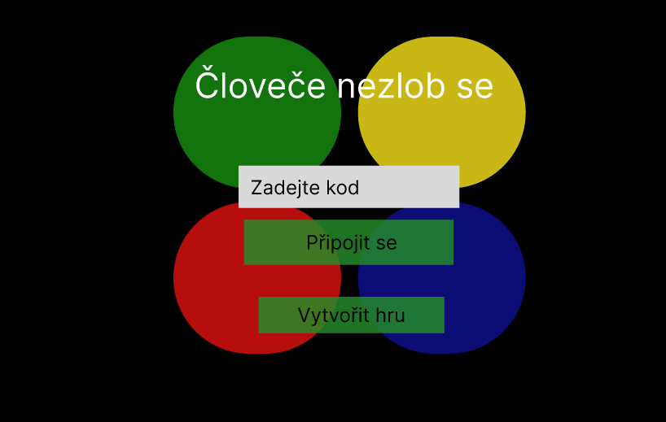
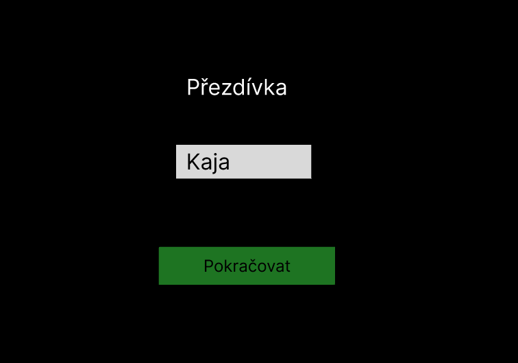
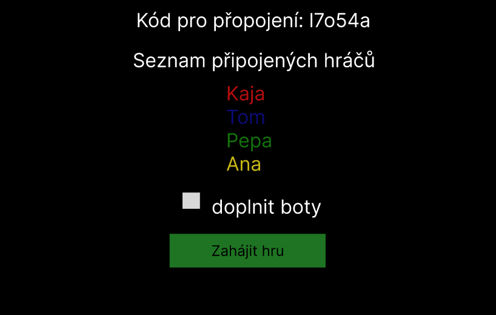
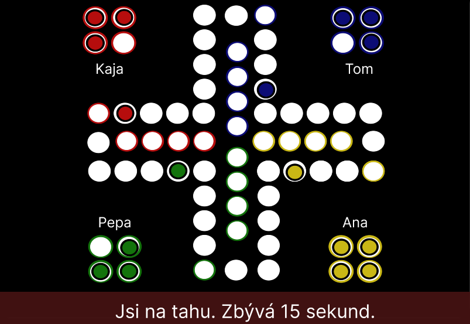
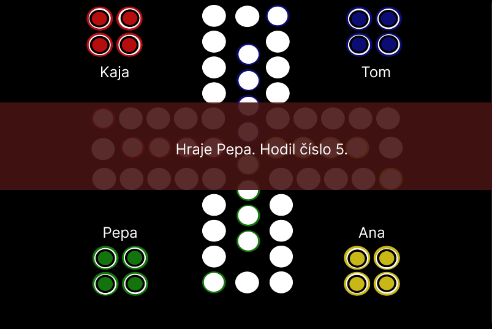
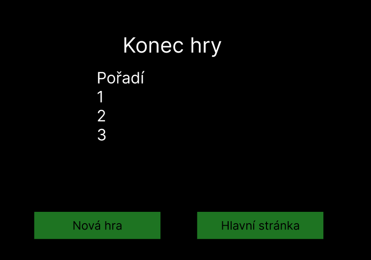

# Zadání

## Název a téma
Naše aplikace se jmenuje: **Člověče, nezlob se! online s přáteli**

## Tým:  
## - Adam Charvát  
- Karolína Virágová  

## Uživatelský průzkum a specifikace
Uživatel je člověk, který má rád deskové hry, ale má většinu přátel v zahraničí.
Chce si s nějakým takovým kamarádem zahrát Člověče, nezlob se! online přes internet.

TODO: Možná více zkonkretizovat?

### Požadavky uživatele:

#### Uživatel A
Shromáždění do lobby před začátkem hry, v lobby vidět kdo bude hrát za jakou barvu. Pohled na desku ze shora (2D). Automatické přesouvání figurek (kliknutí na figurku a ona se posune na příslušné místo). Zobrazit upozornění a kostku (tlačítko pro hození), když je hráč na řadě. Výměnu herní desky považuje za důležitou. Nevyplňovat chybějící hráče boty. Na konci hry výsledná obrazovka s pořadím a výhercem.

#### Uživatel B
Možnost vytvořit místnost (lobby) s kódem pro připojení ostatních hráčů. Tlačítko pro hození kostky. Manuální přesouvání figurky (označení figurky a kliknutí na cílové políčko). Časovač herního kola (časový limit pro hráče). Výměnu herní desky z klasické 2-4 na 5-6 nepovažuje vůbec za důležité. Ideálně mít možnost vyplnit zbylé hráče boty. Zobrazovat aktuální skóre. In-game chat.

#### Uživatel C
Možnost vidět ostatní hráče před začátkem hry, ale barvu přiřadit náhodně. Preferuje 3D pohled na herní desku, aby bylo vidět více detailů. Manuální přesouvání, kde hráč klikne na figurku a poté na cílové políčko pro přesun. Tlačítko pro manuální hod kostkou. Možnost výměny desky je výhodou, ale není zásadní.
Chce možnost hrát i s boty, pokud nejsou dostupní všichni hráči. Preferuje stručný přehled výsledků, spíše rychlé zobrazení pořadí. Také preferuje restartovat hru bez nutnosti vytvářet novou místnost (lobby).

#### Uživatel D
Uvítal by rychlé připojení do hry bez lobby, aby byla hra co nejrychhleji spuštěna. Je pro pohled shora (2D), aby se hra dala jednoduše ovládat a byla přehledná. Automatické přesouvání po kliknutí na figurku, což zrychlí tah. Kostka se hází automaticky, aby byla hra svižnější. Výměnu herní desky nepovažuje za důležité - stačí jedna pevná varianta desky. Nechce boty ani jiná AI řešení, preferuje hru pouze s reálními hráči. Konec hry bez podrobného skóre, pouze vítěz, Nepotřebuje průběžné skóre během hry.

### Shrnutí požadavků

Jelikož různí uživatelé mají různé požadavky, rozhodli jsme se implementovat různá řešení, abychom je mezi sebou porovnali.

#### 1. Lobby a připojení hráčů
- **Lobby**: Většina uživatelů preferuje shromáždění do lobby před začátkem hry. Lobby má zobrazovat seznam hráčů a jejich barvy, barvu přiřadit náhodně.
- **Kód pro připojení**: Hráči se připojí po zadání kódu do stejné místnosti.
- **Restart hry**: Uživatelé požadují možnost restartovat hru bez nutnosti vytvářet novou místnost.

#### 2. Herní desku
- **2D pohled**: Preferovaný pohled shora.
- **Výměna herní desky**: Pro některé uživatele je možnost výměny herní desky důležitá, například varianta pro 5–6 hráčů oproti klasické desce pro 2–4 hráče. Jiní uživatelé tuto možnost nepovažují za zásadní a vystačí si s jednou pevnou verzí desky.

#### 3. Pohyb figurek a házení kostkou
- **Pohyb figurek (varianty řešení)**:
  - **Automatický pohyb**: Preferovaný některými uživateli. Hráč klikne na figurku, která se automaticky přesune na příslušné místo na desce. (Adam Charvát)
  - **Manuální pohyb**: Požadovaný jinými uživateli. Hráč klikne na figurku a následně na cílové políčko pro přesun. (Karolína Virágová)
- **Házení kostkou**:
  - **Manuální hod kostkou**: Uživateli se zobrazí tlačítko pro hod kostky, když je na řadě, kostka je kliknutím vržena. (Adam Charvát)
  - **Automatické házení kostkou**: Preferováno pro zrychlení hry. Kostka se automaticky vrhá, když je hráč na tahu. (Karolína Virágová)

#### 4. Upozornění a časovač
- **Upozornění pro hráče na tahu**: Notifikace a aktivní tlačítko pro hod kostkou, když je hráč na tahu.
- **Časovač tahu**: Možnost nastavení časového limitu na tah pro urychlení hry.

#### 5. Výsledková obrazovka
- **Konečný výsledek hry**: Na konci hry se zobrazí tabulka s výsledky, která bude ukazovat pořadí hráčů a vítěze. Pro některé uživatele stačí stručné zobrazení vítěze bez podrobného skóre, zatímco jiní preferují přehledné pořadí.

## Průzkum existujících řešení

### Aplikace 1: Člobrdo
Odkaz na aplikaci: https://fis-public.s3-eu-west-1.amazonaws.com/clobrdo/index.html

#### Inspirace:
- Přeppínač mezi boty a hráči
- Možnost hrát bez přihlašování, což usnadňuje přístup a okamžitý start.

#### Výhody:
- Okamžité spuštění bez registrace.
- Automatické pohyby figurek šetří čas.
- Jasné označení tahu: Když je hráč na řadě, figurky, kterými může pohnout, jsou označeny, což usnadňuje orientaci.
- Viditelnost hráče na tahu: Vlevo nahoře je zobrazeno, který hráč je na tahu, což pomáhá udržet přehled o aktuálním stavu hry.
Jednoduché ovládání: Uživatelé nemusí složitě hledat, jak pokračovat, vše je intuitivně zobrazeno

#### Nevýhody:
- zmátlo mě možnost nastavení hry s boty nebo hráči, 
- tlačítko pro manuální hod kostkou je malé a nastraně vedle desky. Já bych ho dala pod desku.

### Aplikace 2: Člověče nezlob se
Odkaz na aplikaci: https://www.zahraj.cz/online-hra/clovece-nehnevaj-sa/

#### Inspirace:
- manuální pohyb figurek namísto automatického
- zobrazení obrysu figurky

#### Výhody:
- kostka zobrazena v pravém rohu, panel u hrací desky ukazuje hodnoty hodu, každého hráče
- zobrazení, že je daný hráč na řadě
- při manualním pohybu je zobrazena obrys figurky, kam ji může hráč umístit

#### Nevýhody:
- není možnost nastavit pro více hráčů, hraju sama proti borům
- do hry se není nutné registrovat, ale je to potřeba aby jsi neztratila aktuální hru když odejdeš


### Aplikace 3: Člověče nezlob se - Multiplayer
Odkaz na aplikaci: https://www.zahraj.cz/online-hra/lovee-nehnevaj-sa-multiplayer/

#### Inspirace:
- výměna herní desky?
- lokalizace?

#### Výhody:
- UI je přívětivé pro děti (velikost ovládacích prvků a rozporcování UI na více obrazovek, kdy každá má jeden význam)
- možnost přepnout mezi boty a reálnými hráči a zvolit počet hráčů/botů (2-4)
- při hře figurky, na které lze kliknout blikají nebo se ukazuje ručička nad kostkou, když je hráč na tahu
- hráči si můžou vybrat avatar z předdefinovaných, který se pak zobrazuje vedle jména

#### Nevýhody:
- nelze hrát s konkrétními lidmi, match making je random
- nejde vyměnit herní deska, může být nepřehledná pro některé uživatele, kteří neznají tuto variantu
- chybí šipky pro označení startovního pole nebo pole, ze kterého se dostává do domečku
- místo "auto-mode" mohlo být napsáno, že se za hráče bude automaticky házet kostkou a hýbat figurkama
- maximální počet hráčů jsou 4
- aplikace nepodporuje lokalizaci

### Aplikace 4: Ludo Wizard Game
Odkaz na aplikaci: https://www.hryprodivky.cz/h/ludo-wizard-game-clovece-nezlob-se

#### Inspirace:
- vyplnění hesla místnosti je uživatelsky lepší způsob, než že je heslo vygenerováno a zobrazeno?
- hra s náhodnými hráči nemá u člověče nezlob se smysl

#### Výhody:
- možnost hrát buď s boty, nebo random hráči, nebo přáteli
- vytvoření místnosti pro hraní s přáteli funguje tak, že host vyplní heslo, které sdělí ostatním hráčům a ti ho zadají
- na desce jsou označené startovní a končené pole
- časovač pro hození kostky

#### Nevýhody:
- v případě hraní s random hráči je čekací doba dlouhá (> 5min), navíc se stává, že hráči opustí hru - otázou je, zda-li má tento mód vůbec smysl
- na jednom startovním poli může být více figurek od více hráčů (figurky se nevyhazují)
- figurky jsou fantasy postavičky, které lze těžko od sebe rozeznat (není jasné od které barvy je která figurka)

### Závěry z průzkumu (Aplikace 1 a 2)

1. **Rychlý a snadný přístup**: 
   Obě aplikace (*Člobrdo* a *Člověče nezlob se*) umožňují rychlé připojení k hře bez nutnosti registrace, což zvyšuje komfort hráčů a usnadňuje okamžitý start. Uživatelé oceňují, že se mohou ihned zapojit do hry bez komplikací, což přispívá k lepšímu uživatelskému zážitku. Tento přístup by měl být kladně hodnocen a doporučen pro jakýkoliv budoucí vývoj.

2. **Intuitivní uživatelské rozhraní**: 
   Obě aplikace mají přehledné rozhraní, které je snadné na orientaci. *Člobrdo* využívá automatické pohyby figurek, což šetří čas a zjednodušuje hru, zatímco *Člověče nezlob se* se zaměřuje na manuální pohyb figurek a jasné označení, kam mohou být umístěny. Důraz na jasnou vizualizaci tahů a zobrazení hráče na tahu je klíčovým prvkem, který zvyšuje přehlednost a usnadňuje hru.
Z
3. **Možnosti přizpůsobení a interakce**: 
   *Člobrdo* i *Člověče nezlob se* nabízejí možnosti přizpůsobení hry, ale oba mají určité limity v oblasti interakcí s ostatními hráči. *Člobrdo* umožňuje přepínání mezi hráči a boty, ale neumožňuje konkrétní volbu spoluhráčů, zatímco *Člověče nezlob se* nenabízí možnost více hráčů, pokud není registrace, což může být limitující. Obě aplikace by těžily z přidání možností pro volbu konkrétních spoluhráčů nebo chatování.

### Inspirace pro vlastní návrh (Aplikace 1 a 2)

1. **Zjednodušené přihlášení**: 
   Implementovat systém pro rychlé připojení k hře, který nevyžaduje registraci, inspirovaný aplikací *Člobrdo*. Hráči by mohli okamžitě vstoupit do hry pomocí unikátního kódu, což je efektivní způsob, jak umožnit rychlé začátky bez zbytečných překážek.

2. **Atraktivní a funkční uživatelské rozhraní**: 
   Navrhnout rozhraní, které bude přehledné a snadno ovladatelné. Mělo by být jasně označeno, jakým způsobem mohou hráči pokračovat v hře. Inspirací může být *Člobrdo*, kde automatické označení tahů a pohybů figurek přispívá k intuitivnímu hraní. Rovněž by bylo užitečné implementovat manuální pohyb figurek, jak je to u *Člověče nezlob se*, pro větší kontrolu hráčů nad hrou.

3. **Vylepšené interakce**: 
   Vylepšit interakci mezi hráči, a to buď prostřednictvím chatu, nebo možnosti přizpůsobit herní zážitek. Například u *Člobrdo* je možnost přepínat mezi boty a hráči, ale bylo by přínosné přidat volbu pro konkrétní spoluhráče, což zlepší sociální aspekt hry. Také je možné implementovat automatizované prvky, pokud není dostatek hráčů, podobně jako to dělá *Člobrdo*.

### Závěry z průzkumu (Aplikace 3,4)

1. Díky průzkumu jsme přišli na další způsob vytvoření kódu místnosti, kdy uživatel vymyslí kód sám, může to být pro něj pohodlnější, ale také ne, záleží na provedení - v aplikaci to bylo řešené špatně, jelikož se objevil input field s nadpisem "Password", chvíli jsem nevěděl, co se po mně chce, až pak mi došlo, že si mám vymyslet heslo místnosti - stačilo tam napsat "Create Room/Invite Password".
2. Hra s náhodnými hráči není pro "Člověče, nezlob se" vhodná. Navíc náš uživatel chce hrát se svými přáteli, takže pro nás nemá tento mód vůbec smysl. Na druhou stranu nám tento herní mód ukázal důležitost časovače herního kola, aby byla zachována plynulost hry.
3. Jelikož náš uživatel bude chtít hrát s kamarády ze zahraničí, pak přichází do úvahy lokalizace a výměna herní desky. Zahraniční varianta desky "Člověče, nezlob se" (Ludo) může být pro některé uživatele nepřehledná a to samé se dá říci o té verzi, která je známá v ČR. Implementace client-side výměny desky za jinou variantu, by nebyla možná, protože používá jiný počet polí. Lokalizaci lze jednoduše vyřešit tak, že hra bude pouze v angličtině, uživatel, který má spoustu přátel v zahraničí s největší pravděpodobností bude umět anglicky.
4. Bude lepší, když UI bude rozdělené do více částí, které na sebe logicky navazují, než aby se uživateli zobrazil formulář s 10 vyplňovacími poli.

### Inspirace pro vlastní návrh (Aplikace 3,4)

1. Každý zkusíme vyřešit jinou variantu vytvoření kódu místnosti:\
Adam: kód je vygenerován serverem\
Karolína: kód vymyslí a zadá uživatel
2. Časovač herního kola pro hození kostky.
3. Rozporcování UI na více obrazovek s jedním významem - např. obrazovka pro vyplnění přezdívky s tlačítkem "Pokračovat".

## Zadání
### Popis požadované cílové aplikace
Cílem aplikace je vytvořit online hru s figurkami a hrací kostkou, která umožňuje interakci mezi hráči v místnosti (roomce). Aplikace bude poskytovat herní rozhraní, ve kterém se hráči mohou připojit do místnosti, provádět tahy s figurkami.

Každý člen týmu má jinou funkcionalitu, a výsledná aplikace tedy bude kombinací dvou různých přístupů k ovládání herních prvků.

*Aplikací* se myslí spojená funkcionalita frontendu a backendu (pro jednodušší obecný popis), tyto dvě části jsou jasně odděleny, jak vyplývá z návrhu API k BE.

#### Člen 1: Automatický pohyb figurky a manuální hod kostkou

1. **Automatický pohyb figurky**:
   - Po provedení hodu kostkou vybere uživatel s kterou figurkou chce pohnout, nebo ji umístit na desku. Figurka automaticky vykoná tah podle hodnoty hozeného čísla. Tento tah vypočítá a provede aplikace sama, bez nutnosti uživatelského zásahu.
   - Backend vygeneruje hodnotu kostky a určí novou pozici figurky podle pravidel hry. Frontend pak zobrazí aktuální pozici.

2. **Manuální hod kostkou**:
   - Hráč má v uživatelském rozhraní tlačítko „Hod kostkou“, které po stisknutí vygeneruje náhodné číslo (1-6).
   - Výsledná hodnota z kostky se následně zobrazí hráči a posune figurku o příslušný počet políček.

3. **Heslo do místnosti generované serverem**:
   - Při zakládání nové herní místnosti (roomky) je heslo do místnosti automaticky vygenerováno na straně backendu. Tím je zajištěno, že každá místnost má unikátní a bezpečné heslo.
   - Po vytvoření místnosti backend pošle heslo zpět uživateli, který ho může sdílet s dalšími hráči.

#### Člen 2: Manuální pohyb figurky a automatický hod kostkou

1. **Manuální pohyb figurky**:
   - Hráč může s figurkou pohybovat ručně po herní desce. Například může po hodu kostkou kliknout na figurku a přetáhnout ji na nové místo na základě hodu.
   - Aplikace může zkontrolovat, zda je tah platný, a případně upravit pohyb figurky na základě pravidel hry.

2. **Automatický hod kostkou**:
   - Aplikace při každém tahu sama automaticky vygeneruje hodnotu hodu kostkou (1-6), aniž by hráč musel kostkou házet manuálně.
   - Hráč obdrží výsledek hodu a může podle něj provést manuální pohyb figurky.

3. **Ruční zadání hesla do místnosti**:
   - Když hráč vytváří místnost, může si sám nastavit heslo pro přístup. Toto heslo zadá ručně a aplikace zajistí, že zadané heslo odpovídá bezpečnostním požadavkům.
   - Tímto heslem pak hráč zabezpečí svou místnost a sdílí ho s ostatními, kteří se chtějí připojit.

### Klíčové částí FE
#### Hlavní menu
- **Input box pro kód hry** – připojení ke hře.
- **Tlačítka**:
  - **Připojit** – připojení ke hře po zadání kódu.
  - **Vytvořit** – vytvoření nové hry.

#### Obrazovka pro zadání přezdívky
- **Input box** pro zadání přezdívky.
- **Tlačítko "Pokračovat"** – pokračování do lobby po zadání přezdívky.

#### Lobby
- **Seznam připojených hráčů** – zobrazení všech aktuálně připojených hráčů.
- **Možnost spuštění hry pro hostitele** – hostitel má tlačítko pro spuštění hry.

#### Herní plocha
- **Herní deska** - klasická verze hry s barevnými startovními poli, cílovými poli a cestou kolem dokola.
- **Jména hráčů** – zobrazení jmen hráčů v rozích herní desky.
- **Kostka** – tlačítko pro hod kostkou, které náhodně vygeneruje číslo.
- **Figurky hráčů** – ikony figurek, které se pohybují po herní ploše podle hodnoty hodu.

#### Stavová oznámení
  - "Jsi na tahu" – indikace, že je řada daný hráči.
  - "Červená vyhodila zelenou" – upozornění na události ve hře.
  - "Zbývá 30s do konce tvého kola" – odpočítávání času na tah.
  - "Ivan hodil číslo 6!"

    *Stavová oznámení jsou realizována buď jako overlay text nebo top/bottom bar s textem.*

#### Konec hry a skóre
- Po ukončení hry se zobrazí **tabulka s výsledky** a možnost tlačítko restartu hry nebo návratu na hlavní obrazovku.

### Rozdělení práce v týmu na FE
Každý člen týmu bude vytvářet svůj frontend.

# Návrh

## Návrh GUI

### Karolína Virágová
Návrh je vypracován ve Figmě.


| { width=325px } | { width=325px } |
|---------------------------------------|---------------------------------------|
| * Hlavni obrazovka*                     | *Zadání přezdívky*                     |

| { width=325px } | { width=325px } |
|---------------------------------------|---------------------------------------|
| *Lobby, čekání na připojení ostatních hráčů a tlačítko pro zhájení hry*  | *Hrací deska s figurkami, zobrazují se jména hráčů*   |

| { width=325px } |{ width=325px } |
|---------------------------------------|---------------------------------------|
| *Zobrazení upozornění, že je daný hráč na řadě* | *Zobrazení výsledků, možnost hrát novou hru bez opuštění lobby nebo jít na hlavni stránku a tím se lobby opustí* |


### Adam Charvát

Návrh ve Figmě je vypracován v češtině, výsledná aplikace bude v angličtině.

## Výběr technologií
### Backend
Na prvním meetingu jsme se v týmu domluvili, že backend bude vytvořen v programovacím jazyce Python a bude využívat framework Flask pro HTTP komunikaci. Jelikož cílem aplikace je vytvořit multiplayerovou hru, pak bude nejlepší použít WebSockety pro obousměrnou komunikaci v reálném čase.

Hlavní knihovny:
- Flask
- Flask-SocketIO

### Frontend
Frontend bude každý člen týmu vytvářet v jiném webovém frameworku:  
- Adam Charvát: Angular
- Karolína Virágová: React

## Návrh API k BE

### Datové struktury

#### Player
```ts
interface Player {
    // Unikátní identifikátor hráče
    id: number;
    // Přezdívka hráče
    name: string;
    // Barva - red, green, blue, yellow
    // (barvy jsou přiřazovány hráčům náhodně)
    color: string;
}
```
#### Piece
```ts
interface Piece {
    // Unikátní identifikátor figurky
    id: number;
    // ID hráče, který vlastní figurku
    ownerId: number; // Player.id
    // Barva figurky, stejná jako Player.color
    color: string;
    // Pozice vzhledem k celkové cestě, kterou musí figurka ujít,
    // pokud je pozice null, pak figurka ještě nebyla umístěna na herní desku,
    // pokud je pozice >= Game.commonLength, pak je figurka v domečku
    position: number | null;
    // Pozice v rámci společného místa herní desky,
    // pokud je společná pozice null, figurka ještě nebyla umístěna na herní desku, nebo je v domečku
    commonPosition: number | null;
}
```
#### Game
```ts
interface Game {
    board: {
        /* Délka společného místa na desce, klasicky 40 polí */
        commonLength: number;
        /* Délka domečku, klasicky 4 pole */
        houseLength: number;
        // Maximální počet hráčů
        maxPlayers: number;
        // Figurky
        pieces: Piece[];
    },
    // Hráči v místnosti
    players: Player[];
    // Hráč, který je na tahu
    nextPlayerId: number; // Player.id
}
```

#### Collision Info
```ts
interface CollisionInfo {
    // 'kicked': Figurka byla vyhozena
    // 'denied': Figurce byl zamítnut pohyb
    //  (např. nelze vyhodit vlastní figurku v domečku)
    action: 'kicked' | 'denied';
    // 'kicked': Společná pozice, na které nastala kolize
    // 'denied':
    //    >= 40 (pozice v domečku, která je obsazená)
    //    < 40  (společná pozice, která je obsazená)
    position: number;
    // 'kicked': Figurka, kterou je potřeba aktualizovat
    // 'denied': Žádná změna (stejná figurka)
    piece: Piece;
    // 'kicked': Hráč, který kolizi způsobil a vyhodil jinou figurku
    // 'denied': Hráč, jehož figurce byla odmítnuta změna pozice
    issuedById: number; // Player.id
}
```

V závislosti na verzi pravidel, je možné řešit kolizi:
- Hráč, kterému byl zamítnut pohyb hraje znovu
- Posunutím kola na dalšího hráče

#### Score Record

```ts
interface ScoreRecord {
    // ID hráče
    playerId: number;
    // Hodnota figurek v domečku
    value: number;
}
```

### Socket.IO události

### Události vyvolané knihovnou

Event `connect`

Event `disconnect`

### Události vyvolané klientem

Události jsou vyvolávané voláním funkce `emit(eventName, payload, callback)`. Klient dostane `response` jako argument callbacku.

`payload` = *data, která posíláme na server*\
`response` = *data, která server zašle zpátky jako odpověď*

V případě chyby pošle server číselný atribut `error` v objektu `response`. Žádné další atributy v tomto případě `response` nemá.

**Event** `session:create`\
*Vytvoření místnosti (lobby)*
```ts
payload: {
    // Přezdívka vlastníka místnosti
    name: string;
    // Vlastní klíč místnosti (nemusí být uveden)
    key: string | undefined;
}

response: {
    // Klíč k nově vytvořené místnosti
    key: string;
    // Vlastník místnosti
    owner: Player;
    // Klienti v místnosti (zatím jen jeden)
    players: Player[];
}
```
Pošle `error`, pokud je specifikován `key` v `payload` a session se stejným klíčem již existuje.

**Event** `session:join`\
*Žádost o připojení do místnosti*
```ts
payload: {
    // Klíč k místnosti
    key: string;
    // Přezdívka připojujícího se klienta
    name: string;
}

response: {
    // Klíč k místnosti
    key: string;
    // Vlastník místnosti
    owner: Player;
    // Nově připojený hráč
    me: Player;
    // Aktuálně připojení klienti ve stejné místnosti
    players: Player[];
}
```
Pošle `error`, pokud je `key` neexistuje.

**Event** `game:start`\
*Žádost o zahájení nebo restart hry*
```ts
payload: {
    // Zda vyplnit zbylé hráče boty
    fillWithBots: boolean;
}
```

**Event** `game:play`\
*Žádost o hození kostky - vygenerování náhodného čísla (žádný `payload`)*

**Event** `game:movePiece`\
*Žádost o pohnutí figurky*
```ts
payload: {
    // Společná pozice figurky, s kterou se má pohnout
    commonPosition: number;
}
```

**Event** `game:deployPiece`\
*Žádost o umístění nové figurky na startovní pole*

Žádný `payload`, na herní desku se umístí první neumístěná figurka hráče.

### Události vyvolané serverem

Události jsou vyvolávané voláním funkce `emit(eventName, data)`.

**Event** `session:joined`\
*Oznámení všem klientům v jedné místnosti (kromě nově připojeného), že se připojil nový klient*
```ts
// Nově připojený klient
data: Player
```

**Event** `game:started`\
*Oznámení o zahájení hry všem klientům v místnosti*
```ts
// Data potřebná pro vykreslení herní desky GUIčkem
data: Game
```

**Event** `game:diceRolled`\
*Oznámení všem v místnosti, že hráč hodil kostku*
```ts
data: {
    // ID hráče, který hodil kostku
    playerId: number;
    // Číslo 1 - 6
    dice: number;
    // Pokud padlo číslo 6, může hráč umístit novou figurku na desku.
    canDeploy: boolean;
}
```

**Event** `game:updated`\
*Žádost všem klientům o upravení datového modelu hry*
```ts
data: {
    // Informace o kolizi, pokud nastala
    //   V případě kolize typu 'kicked',
    //   obsahuje informace o další figurce,
    //   kterou je potřeba aktualizovat
    //   (CollisionInfo.piece)
    collision: CollisionInfo | null;
    // Aktualizovaná figurka, kterou je potřeba nahradit v datovém modelu
    updatedPiece: Piece;
    // Další hráč na tahu
    nextPlayerId: number;
}
```

**Event** `game:ended`\
*Oznámení o tom, že hra skončila*
```ts
data: {
    // Informace o skóre každého hráče
    score: ScoreRecord[];
    /* Délka domečku, klasicky 4 pole */
    houseLength: number;
}
```

### Napojení FE na BE (GUI na API)  

#### 1. React

**Vytvoření místnosti**

- **Komunikace mezi FE a BE**: Klient na GUI odešle na server událost `session:create`, což inicializuje herní místnost.
- **Event**: `session:create`
- **Vstupní data**:
  - `name` – přezdívka hráče
  - volitelně `key` – vlastní klíč místnosti, pokud si hráč přeje nastavit vlastní kód
- **Odpověď serveru**: Server vrátí:
  - `key` – kód místnosti
  - `owner` – vlastník místnosti
  - `players` – seznam aktuálně připojených hráčů (na začátku bude pouze vlastník)  

Zobrazí `key` jako kód místnosti, který lze sdílet s ostatními hráči, aby se mohli připojit do hry.

**Připojení do místnosti**

- **Komunikace mezi FE a BE**: Po zadání kódu místnosti na GUI klient odešle událost `session:join`.
-**Event**: `session:join`
- **Vstupní data**:
  - `key` – kód místnosti
  - `name` – přezdívka hráče, který se chce připojit
- **Odpověď serveru**: Server vrátí:
  - `key` – kód místnosti
  - `owner` – vlastník místnosti
  - `me` – údaje o nově připojeném hráči
  - `players` – aktuální seznam hráčů v místnosti  

Aktualizuje a zobrazí seznam hráčů připojených k místnosti. Událost `session:joined` se odešle ostatním hráčům v místnosti, aby byli informováni o novém hráči.

**Automatický hod kostkou**

- **Komunikace mezi FE a BE**: Jakmile je na tahu nový hráč, server automaticky odešle událost `game:diceRolled`, čímž se simuluje hod kostkou. Tato událost probíhá bez nutnosti uživatele klikat na tlačítko „Hodit kostkou.“

- **Event**: `game:diceRolled`
- **Vstupní data**: žádná (vyvolává server automaticky při zahájení tahu hráče)
- **Odpověď serveru**: Server vrátí všem klientům informaci o výsledku hodu kostkou (1–6) spolu s příznakem, zda hráč může nasadit novou figurku (`canDeploy: boolean`).

Frontend obdrží událost `game:diceRolled`, aktualizuje zobrazení hodnoty hodu kostkou na herní desce, a hráč může následně vybrat figurku pro tah.

**Kliknutí na figurku a výběr cílového políčka**

- **Komunikace mezi FE a BE**: Když uživatel klikne na figurku a vybere cílové políčko, frontend odešle požadavek na server pomocí události `game:movePiece`.

- **Event**: `game:movePiece`
- **Vstupní data**: `{ commonPosition: <cílová pozice figurky> }`
- **Odpověď serveru**: Server potvrdí pohyb figurky a vyšle zpět aktualizované herní informace přes `game:updated`, což zahrnuje nové pozice, informace o případných kolizích a dalšího hráče na tahu.

**Zahájení nové hry**

- **Komunikace mezi FE a BE**: Při kliknutí na tlačítko pro zahájení nové hry frontend odešle požadavek `game:start`, což spustí hru a zobrazí všechny hráče na herní desce.

- **Event**: `game:start`
- **Vstupní data**: `{ fillWithBots: <boolean, vyplnit prázdná místa boty> }`
- **Odpověď serveru**: Server odpoví `game:started`, kde předá kompletní nastavení hry (struktura `Game`).

**Kliknutí na tlačítko Reset**

- **Komunikace mezi FE a BE**: Po kliknutí na tlačítko Reset frontend odešle požadavek na server pro resetování hry. Tento krok se provádí vytvořením nové session nebo opětovným načtením.

- **Event**: `session:create` nebo specifická resetovací událost, pokud je implementována
- **Vstupní data**: `{ key: <identifikátor místnosti>, name: <jméno hráče> }`
- **Odpověď serveru**: Server vrátí klíč nové nebo obnovené herní session, případně další potřebné informace, aby se hra mohla znovu načíst na frontendu.

#### 2. Angular

**Lobby**

Event `session:create` nebo `session:join` dodá prvku `LobbyComponent` úvodní data k zobrazení.
Tyto události jsou na straně klienta vyvolány a zaslány backendu v reakci na kliknutí uživatele:
- Tlačítko "Připojit se do hry": `session:join`
- Tlačítko "Vytvořit hru": `session:create`

Úvodní data se dále aktualizují v reakci na `session:joined`, kdy server pošle data nově připojeného hráče.

Tlačítko majitele místnosti "Zahájit hru", po kliknutí na toto tlačítko je vyvolána událost `game:start`.

**Herní deska**

Úvodní data do prvku `BoardComponent` se načtou posloucháním a čekáním na událost `game:started`, kdy server pošle všem klientům `Game` data (popsaná výše).

Podle toho, kdo je na tahu, má přístup k tlačítku kostky, toto tlačítko vyvolá událost `game:play`.

Backend událost vyhodnotí a pošle všem klientům `game:diceRolled` s hodnotou kostky, která byla vržena a její hodnota vygenerována. Hodnota kostky se zobrazí v GUI na kostce.

Hráč, který kostkou hodil, pokud mu padla šestka, pak má 2 možnosti:
- Umístit na desku novou figurku, kliknutím na figurku se pošle event `game:deployPiece`
- Pohnout s libovolnou figurkou, která už je na desce, kliknutím na figurku se pošle event `game:movePiece`.

Pokud hráč šestku nehodil, pak má pouze možnost pohnout s figurkou, která už je na desce. Pokud nemá na desce žádnou figurku, pak pošle `game:deployPiece`, který mu backend zamítne.

Backend by neměl automaticky vyhodnotit, že hráč nehodil šestku a nemá žádnou figurku na desce, s kterou by mohl pohnout, a tak přepnout na dalšího hráče a poslat `game:updated`. Narušovalo by to plynulost hry, kdy GUI by nemusely stíhat zobrazovat hodnotu kostky.

Backend v reakci na následující události rozešle všem broadcast `game:updated`, který obsahuje aktualizovanou figurku, která se změnila. Může také obsahovat kolizi, která obsahuje další aktualizovanou figurku, která se díky kolizi přesunula na začátek (pouze v případě `action = kicked`). GUI je zodpovědné za aktualizaci svého datového modelu těmito hodnotami.

Pokud klient v dostatečné době (např. 30s) nezašle `game:play`, `game:movePiece`, `game:deployPiece`, pak backend automaticky zašle `game:updated` a na tahu je další hráč. Hodnotu časovače GUI obdrží společně s `nextPlayerId`.

Když backend identifikuje výherce, rozešle všem `game:ended` obsahující výsledné skóre, které GUI zobrazí ve výsledkové tabulce.

Ve výsledkové tabulce jsou tlačítka:
- "Hrát znovu", kliknutí vyvolá událost `game:start`
- "Návrat do lobby", kliknutím vyvolá událost `session:leave`
